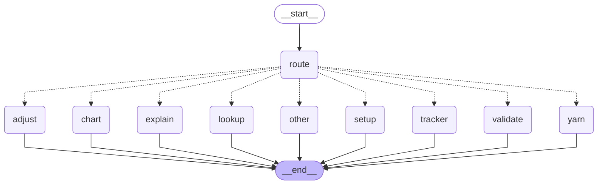

# Chat graph (LangGraph)

Generated from the code: `python -c "from knit_copilot import graph; print(graph.mermaid())"`.
Each node is a thin adapter around one component (see `src/knit_copilot/graph.py`).

