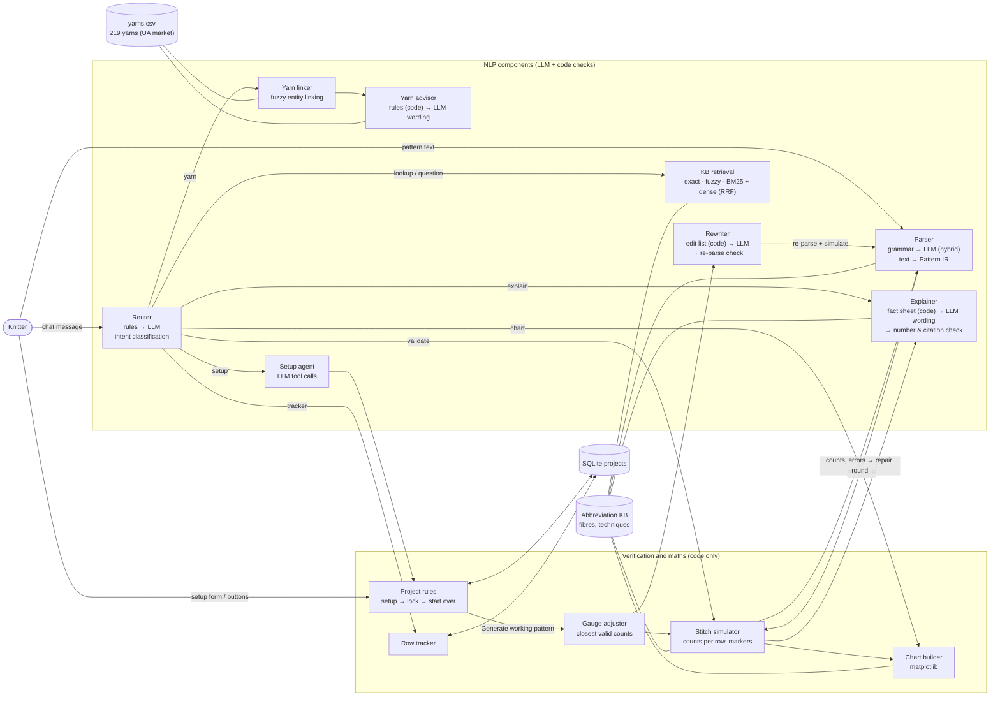

# System diagram — Knitting Copilot

Data flow of the whole system. **LLM** = model call (`llm.py`, OpenAI-compatible API); **code** = deterministic
Python; **KB** = `data/kb/*.yaml`; **DB** = SQLite (`db.py`). The chat graph (LangGraph) is in
[chat_graph.md](chat_graph.md).

## One input through the system (walkthrough)

Message in the "My project" chat: *"I'm knitting YarnArt Jeans on US 6 needles, my swatch is 22 sts and 30 rows over 10 cm"*

1. **Router**: no rule matches the whole message. The LLM gets the intent definitions and returns `setup`.
2. **Setup agent**: the LLM gets the tool list and the project status, and calls
   `set_yarn(name="YarnArt Jeans")`, `set_needles(size=6, system="us")`,
   `set_gauge(stitches=22, rows=30, over=10, unit="cm")`. It copies the numbers as written.
3. **Project rules (code)**: the yarn linker resolves "YarnArt Jeans" to one row of `yarns.csv`. US 6 → 4.0 mm
   (table). The gauge is stored per 10 cm. Each tool returns ok/message. The stage is still `setup`, so changes are
   allowed.
4. The tool results go back to the LLM, which writes the reply ("Saved: YarnArt Jeans, 4 mm, 22 × 30 …").
5. The project is saved in SQLite. The trace shows: route (1 LLM call) → setup (2 LLM calls, 3 tool calls).
6. **Generate working pattern** (button or chat): the gauge adjuster finds the closest cast-on that keeps every
   repeat whole, simulates the new pattern and locks the project. The row tracker starts at row 1.
